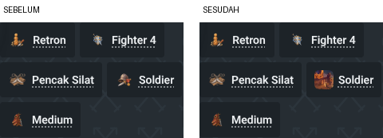
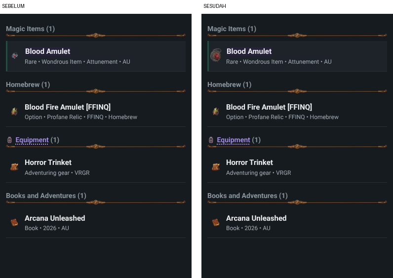
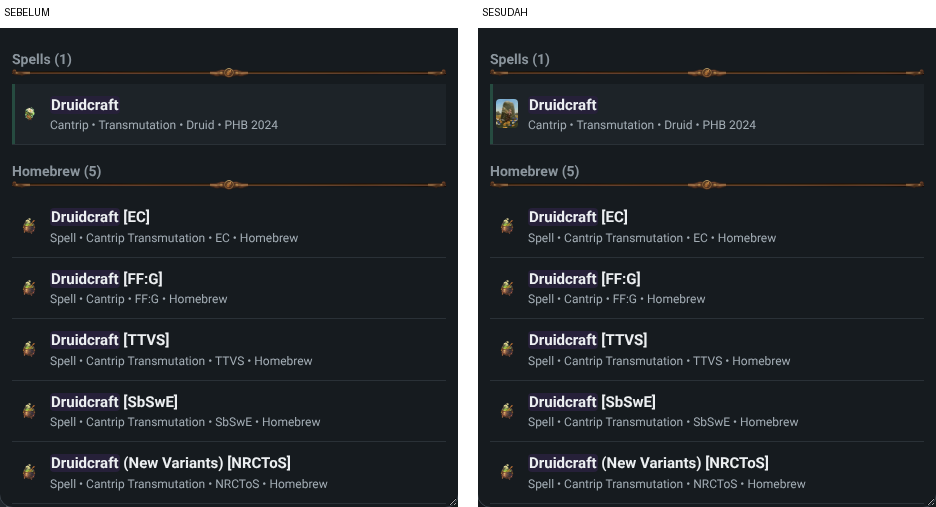
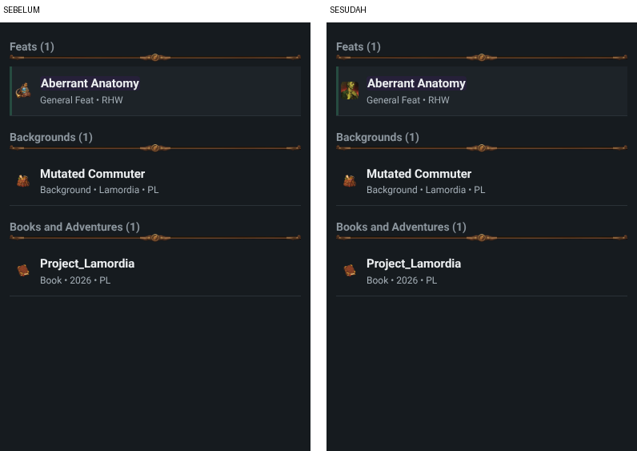
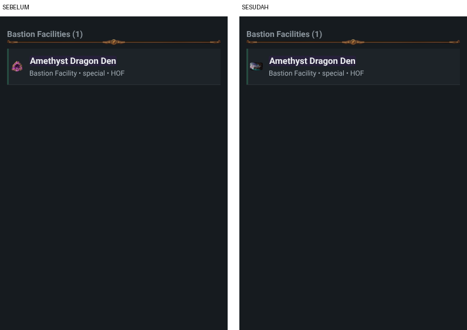
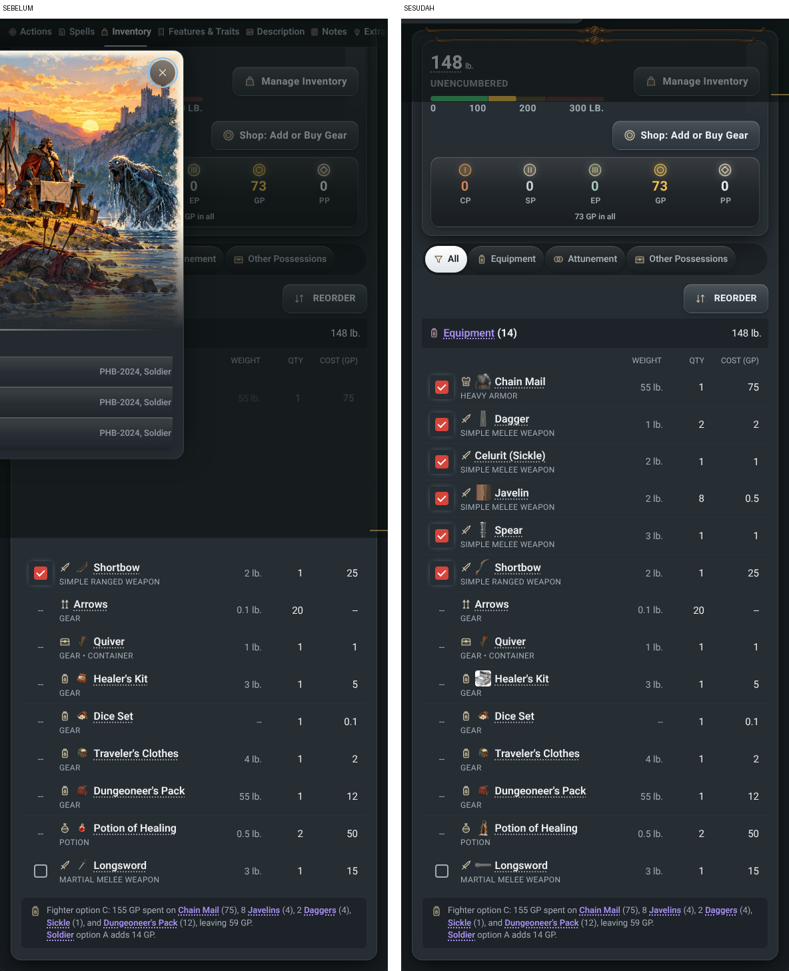
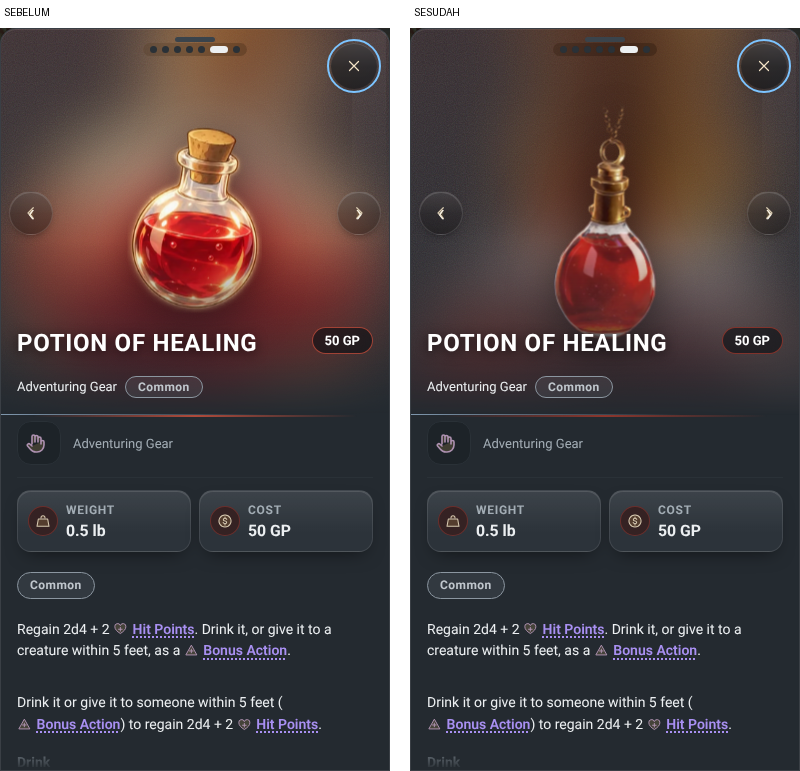
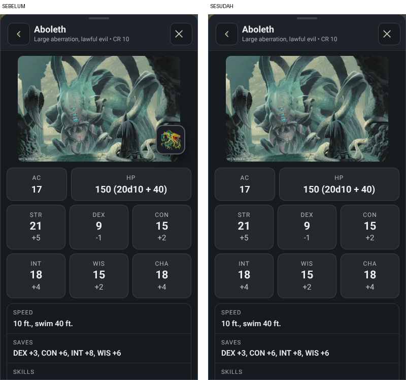

# Art dedupe: hapus art Codex yang entrinya sudah punya gambar 5etools (2026-11-09)

Keputusan pemilik: "hapus art Codex jika sudah ada full image dari 5etools". Cabang `claude/art-dedupe`. Tidak ada art baru.

## Hasil

| Ukuran | Sebelum (main d5584092) | Sesudah |
|---|---|---|
| File `dist/` (`sh tools/pages_dist.sh`) | 20.999 | 18.125 (-2.874) |
| File `dist/img` | 12.387 | 9.513 |

Angka di atas hanya dari cabang ini. Pengurangan dari sisi `data/hb` dan potret (cabang `claude/dist-under-20k`) datang terpisah.

## Cara memetakan (logika aplikasi, bukan nama file)

Skrip Playwright memuat `index.html`, lalu untuk 18.534 entri Library (tanpa homebrew) memanggil fungsi aplikasi sendiri:

- `window.__artIc(kategori, nama)`: file Codex yang dipilih aplikasi untuk entri itu (dipakai di daftar Library, daftar spell, inventaris, chip kondisi, judul detail).
- `window.__libHtml(c, k)`: ada atau tidak gambar 5etools (`data/img/...webp`) di detail Library entri itu (jalur QREFS lalu QIMG, sama dengan `libDetailStep2`).
- Creature: kunci `A.mon` dicocokkan dengan aturan `monKey`/`mslug` di `src/fx/27-blend-sheet.js` ke entri bestiary yang punya gambar `bestiary/`.

Satu file Codex dihapus hanya bila **semua** entri yang dilayaninya punya gambar 5etools dan file 5etools itu ada di disk. File yang melayani campuran (contoh `img/icon/feat/poisoner.avif`: feat Poisoner punya gambar, fitur Poisoner tidak) tetap.

## Jumlah file dihapus per kelompok

| Kelompok | Kunci | File kecil | File HD | Total |
|---|---|---|---|---|
| Ikon item (magic item dan gear) | 544 | 544 | 544 | 1.088 |
| Ikon species | 105 | 105 | 105 | 210 |
| Ikon background | 95 | 95 | 95 | 190 |
| Ikon spell | 87 | 87 | 87 | 174 |
| Ikon feat | 37 | 37 | 37 | 74 |
| Ikon kondisi | 13 | 13 | 13 | 26 |
| Ikon bastion facility | 12 | 12 | 12 | 24 |
| Ikon bahasa, vehicle, object | 6 | 6 | 6 | 12 |
| Lukisan creature (`img/mon`, `img/hd/mon`) | 538 | 538 | 538 | 1.076 |
| **Jumlah** | **1.437** | | | **2.874** |

Tidak dihapus:

| Kelompok | Alasan |
|---|---|
| `img/scn/species`, `img/scn/background` (146 kunci dengan gambar 5etools, 292 file) | Builder memakai scene ini untuk latar langkah, banner, dan kartu pilihan species. Builder tidak punya gambar 5etools di peran itu, jadi bila dihapus builder kehilangan gambar (atau harus diganti potret 5etools yang bentuknya tegak, bukan lanskap). Perlu keputusan pemilik. |
| `img/scard`, `img/scene`, `img/emblem`, ikon kategori, ikon ukuran, skill, damage, creature type | Tidak ada pasangan gambar 5etools untuk peran itu. |
| `img/mon` eldritch-cannon, homunculus-servant-tiny-winged-construct | Tidak ada gambar bestiary 5etools. |
| `img/portrait`, `data/hb` | Wilayah agen lain. |

## Apa yang berubah di tampilan

**(a) Tidak berubah.** Detail Library item, spell, feat, species, background, creature tetap menampilkan gambar 5etools yang sama. Langkah builder (species, background, equipment) identik piksel per piksel.

**(b) Berubah, pemilik perlu tahu.** Tempat kecil yang tadinya memakai ikon Codex sekarang memakai gambar 5etools entri itu, dipotong ke kotak yang sama lewat CSS (`.art-5e`, `object-fit:cover`). Tidak ada slot kosong.

| No | Tempat | Sebelum | Sesudah | Screenshot |
|---|---|---|---|---|
| 1 | Chip identitas sheet (Background Soldier, Yudhi) | ikon Codex | gambar 5etools Soldier |  |
| 2 | Daftar Library, magic item (Blood Amulet) | ikon Codex | gambar 5etools kecil |  |
| 3 | Daftar Library, spell (Druidcraft) | ikon Codex | gambar 5etools kecil |  |
| 4 | Daftar Library, feat (Aberrant Anatomy) | ikon Codex | gambar 5etools kecil |  |
| 5 | Daftar Library, bastion facility (Amethyst Dragon Den) | ikon Codex | gambar 5etools kecil |  |
| 6 | Inventaris sheet (Chain Mail, Dagger, Javelin, Spear, Shortbow, Healer's Kit, Potion of Healing, Longsword) | ikon Codex | gambar 5etools kecil |  |
| 7 | Detail sheet (kartu blend) item atau spell, contoh Potion of Healing | ikon Codex HD menggantikan foto buku | foto 5etools (sesuai aturan gambar proyek) |  |
| 8 | Detail creature (Aboleth) | tombol kecil "Show the painted version" di sudut | tombol hilang, gambar 5etools tetap |  |

Catatan screenshot 6: pada run "sebelum" lembar detail Soldier masih menutup bagian atas inventaris (urutan klik skrip). Baris yang terlihat (Shortbow sampai Longsword) cukup untuk dibandingkan.

Run pertama sesudah hapus menunjukkan baris feat lebih tinggi 12 px karena gambar 5etools tidak persegi. Sudah diperbaiki dengan `.lib-ri .art-ic.art-5e{height:auto;aspect-ratio:1}`. Screenshot 4 diambil dari run terakhir (sesudah merge main).

## Perubahan kode dan data

| File | Isi |
|---|---|
| `img/manifest.json`, `src/fx/23-class-art-data.js` | 1.437 kunci keluar dari `icon.<kat>` dan `mon`. Kunci baru `icon5`: peta `kategori -> slug -> jalur 5etools` (hasil pemetaan di atas) untuk tempat kecil. |
| `src/fx/24-class-art.js` | `__artIc`: ikon Codex dulu, bila tidak ada pakai `icon5` (``). Kartu blend tidak lagi menimpa foto 5etools karena pola `img/icon/` tidak cocok. |
| `src/app/08-ui-render-sheet-and-actions.js` | Chip species dan background: Codex, lalu `icon5`, lalu ikon "custom". |
| `src/css/32-class-art.css` | Aturan `.art-5e` (potong ke kotak kecil, utuh di watermark detail, persegi di daftar Library). |
| `img/codex-q.json` | 1.146 jalur yang dihapus keluar dari ledger. |
| `img/codex-q-src.json` | 2.874 jalur ditandai `"dihapus: ada 5etools"`. |
| `tools/art_codex_q.py` (dipakai `tools/art_codex_release.py`) | `newer()` menolak jalur bertanda itu (kecil atau HD), jadi rilis Codex berikutnya tidak memasang ulang dan tidak menambah kunci manifest. |
| `tests/detail_img.py` | Harapan Potion of Healing diganti: sekarang foto 5etools, bukan ikon Codex HD. |

Kunci localStorage dan bentuk data tersimpan tidak berubah.

## Bukti

| Bukti | Hasil |
|---|---|
| Jejak jaringan Playwright 390x844 dan 1250x850: sheet Yudhi (chip, kondisi, detail, inventaris), Library satu entri per kategori (item, spell, feat, bestiary, species, background, deck, recipe, language, facility, gear, rule), builder semua langkah | 0 permintaan gambar gagal atau 404 (run sebelum, sesudah, dan sesudah merge main). Deck: pencarian Library tidak memunculkan baris deck, jadi dicek lewat `__libHtml('deck', ...)` yang dipasang ke halaman: deck tidak punya gambar di detail Library dan tidak ada permintaan gagal. Recipe Abyssal Chicken Egg Omelet: gambar 5etools termuat. Satu-satunya 404 adalah `/api/me` (server statis lokal tanpa API, juga ada di main). Permintaan `img/mon` turun dari 1 ke 0, `data/img` naik dari 11 ke 29. |
| Tiga skenario wajib (`tests/scenarios.py`) | 24 cek lulus. `tests/compare_storage.py` sebelum vs sesudah: 6 file, 0 beda. |
| `tests/solid_snapshot.py` | 2997 build, total f65fce1937133458 (sama). |
| golden_builds, fx_engine, solid_contract, solid_data_contract, solid_ui_contract, csp_check, names_lint, version_label, e2e_fx_toggle, q_lib, xlinks | lulus semua |
| Tes gambar: art_install, blank_new, builder_art, detail_img, q_img, sub_art | lulus |
| Tes gambar: vignettes | 4 gagal (natural-20 dan natural-1). Gagal yang sama terjadi di `index.html` main. Tidak terkait (`img/vig` tidak disentuh). |
| `tests/guard_all.py --enforce` | exit 0 |
| `tools/tsc_gate.py` | 203 (sama dengan main) |
| `tools/html_gate.py` | 250 (baseline 250) |
| Rujukan sisa ke file yang dihapus (src, tests, tools, sw.js, index.html, data/*.js) | 0 |

## Risiko

| Risiko | Tingkat | Catatan |
|---|---|---|
| Daftar Library memuat gambar 5etools penuh (rata-rata 36 KB) untuk 899 entri, bukan ikon 128 px | sedang | Gambar `loading="lazy"`, hanya baris yang terlihat. Lebih berat di jaringan lambat. Alternatif: pakai ikon kategori, satu baris kode di `__artIc`. |
| Tombol lukisan creature hilang untuk 538 creature | rendah | Opsi B pemilik sebelumnya (5etools dulu, lukisan sebagai alternatif). Gambar utama tetap. |
| Alat art lama (`tools/art_icons2.py`, `art_grid*.py`, `art_misc.py`) tidak membaca tanda `"dihapus: ada 5etools"` | rendah | Itu pemasang batch lama sekali jalan. Pemasang aktif (`art_codex_q.py` lewat `art_codex_release.py`) sudah menolak. |
| Potret 5etools yang tegak dipotong ke kotak 24 px di chip | rendah | `object-position:50% 25%` menjaga bagian kepala. |
